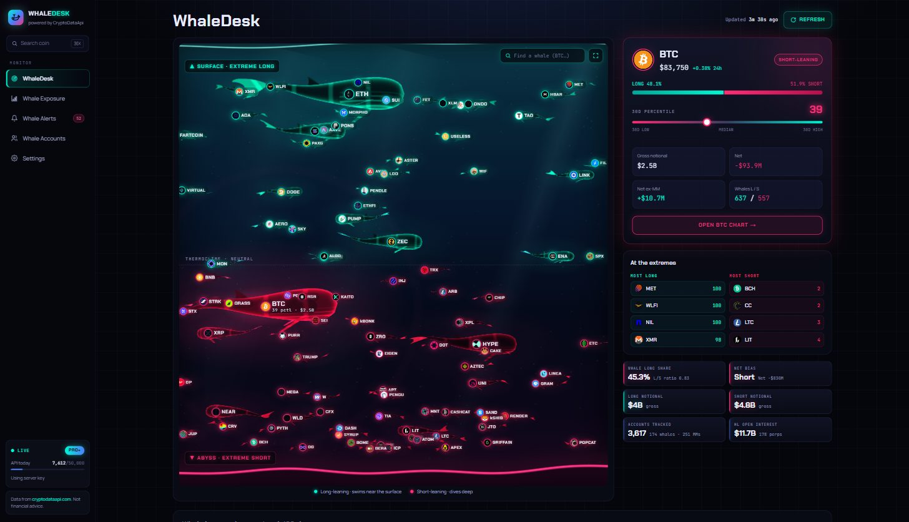
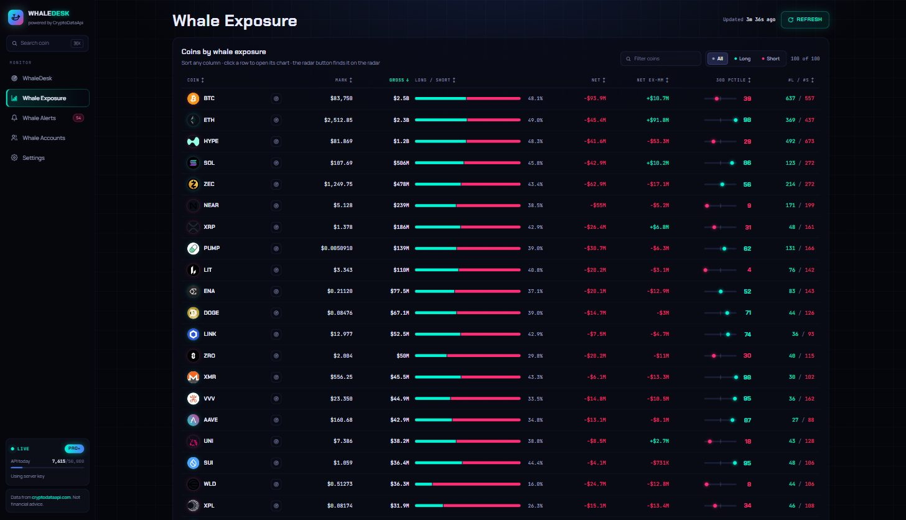
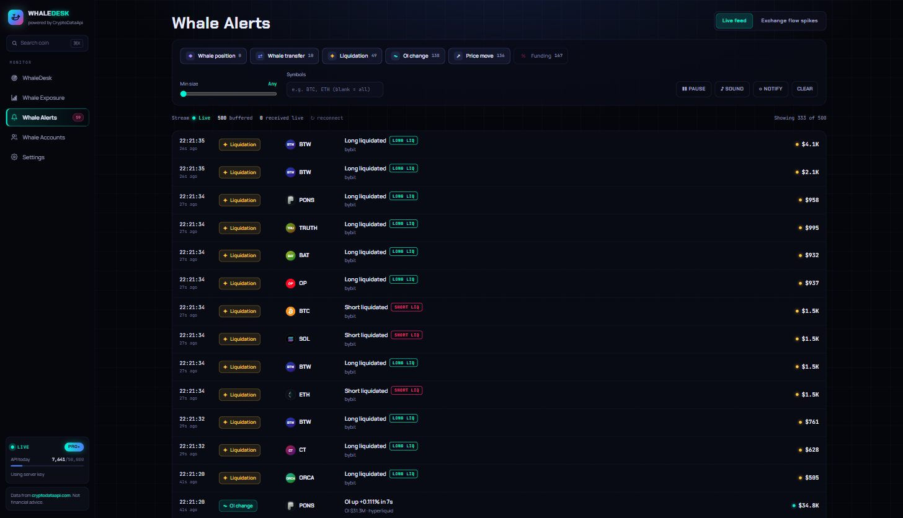
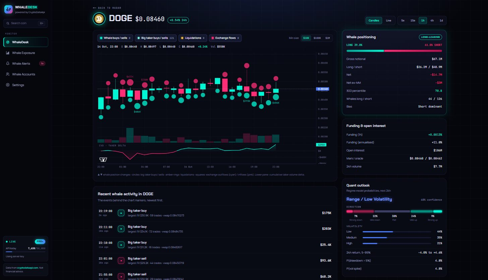
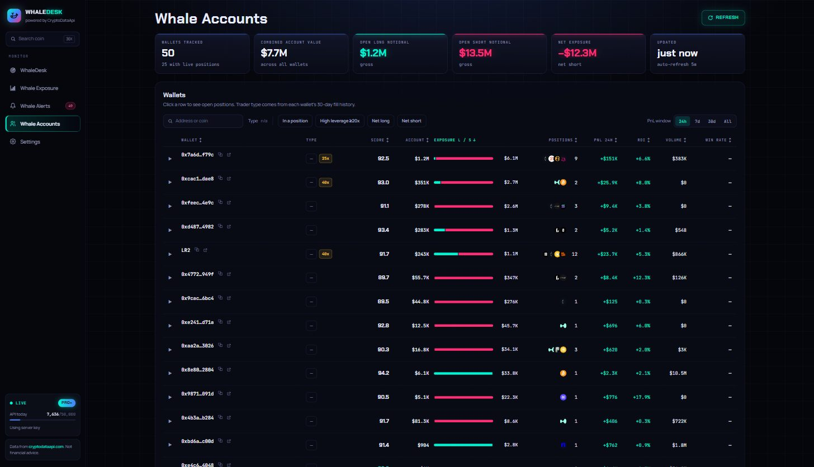

# Crypto Whale Dashboard

A real-time dashboard for tracking crypto whale activity, powered by [CryptoDataApi.com](https://cryptodataapi.com).

## Live demo

**https://crypto-data-api.github.io/crypto-whale-dashboard/**

The demo is a static build that shows a **sample snapshot** of real CryptoDataApi responses. Timestamps are shifted so the data ends "now", and a few recent alerts are replayed every 20–40 seconds so the feed moves. It cannot show live data, for two reasons:

- GitHub Pages only serves static files, so there is no server to hold an API key or proxy requests.
- CryptoDataApi does not send CORS headers, so a browser page cannot call the API directly.

For live data, run the app yourself with a key. See [Get a key and run it live](#get-a-key-and-run-it-live).

## Screenshots

| WhaleDesk | Whale Exposure |
|---|---|
|  |  |
| Every coin is a whale, swimming at a depth set by how far whales lean long or short against its 30-day norm. | Every coin's whale book in one sortable table. |

| Whale Alerts | Coin chart |
|---|---|
|  |  |
| Live feed of whale positions, transfers, liquidations, OI and price moves. | Candles with whale buys and sells, liquidations and exchange flows, plus CVD. |

| Whale Accounts |
|---|
|  |
| Tracked Hyperliquid whale wallets with trading style, PnL and open positions. |

## What it does

- **WhaleDesk** – a 3D ocean of whales, one per coin: long-leaning coins swim near the surface, short-leaning ones dive deep, sized by Hyperliquid whale notional and ranked against their 30-day norm.
- **Whale Exposure** – every coin's whale gross, long/short split, net, net ex-MM and 30-day percentile in one sortable table.
- **Whale Accounts** – tracked Hyperliquid whale wallets with their trading style, PnL and open positions.
- **Whale Alerts** – a live feed of whale position changes, on-chain exchange transfers, liquidations, OI and price moves, with sound and browser notifications.
- **Coin charts** – click any coin to open its price chart with whale buys/sells, liquidations and exchange flows plotted on the candles, plus a CVD pane.
- **Coin context** – whale positioning, funding and open interest, regime-model probabilities and news next to the chart.
- **Settings** – bring your own CryptoDataApi key (Free, Pro or Pro Plus) and tune thresholds, refresh rates and alerts.

Traders, Market and Scanners pages are stubs that list the endpoints they will use (see [PLAN.md](PLAN.md), milestones 5–6).

## Get a key and run it live

1. Get a CryptoDataApi key at **[cryptodataapi.com/pricing](https://cryptodataapi.com/pricing)** ([API docs](https://cryptodataapi.com/api/docs)). A free key works for candles and the delayed alerts feed; Pro unlocks whale positioning, the live stream and trade flow.
2. Run the dashboard (Node.js 20.9+, 22.13+ recommended):

```bash
git clone https://github.com/Crypto-Data-API/crypto-whale-dashboard
cd crypto-whale-dashboard
npm install
cp .env.example .env    # then set CDA_API_KEY=your_cryptodataapi_key in .env
npm run dev
```

3. Open http://localhost:3000. The tier badge in the sidebar shows your plan (FREE, PRO or PRO+) instead of SAMPLE.

You can also paste your key in **Settings** instead of using `.env`. It is checked against `GET /auth/keys/me`, and the tier badge, rate-limit meter and features update immediately. A key saved in Settings always takes priority over the server key.

### Let an AI coding agent set it up

Paste this into Claude Code, Cursor or any agent that can run shell commands. The same prompt, with a copy button, is on the demo's radar banner and Settings page.

```text
Set up the Crypto Whale Dashboard locally (needs Node.js 20.9 or newer).
1) git clone https://github.com/Crypto-Data-API/crypto-whale-dashboard and cd into crypto-whale-dashboard.
2) Run npm install.
3) Create a .env file in the project root containing CDA_API_KEY=<my CryptoDataApi key>. I will paste the key; if I haven't, ask me for it or tell me to get one at https://cryptodataapi.com/pricing. A free key works for candles and the delayed alerts feed; Pro unlocks whale positioning, the live stream and trade flow.
4) Run npm run dev and open http://localhost:3000.
5) Confirm the tier badge in the sidebar shows my plan (FREE, PRO or PRO+, not SAMPLE) and the WhaleDesk page shows live data.
Optional: deploy to Vercel with CDA_API_KEY set as an environment variable. GitHub Pages can only host the sample demo, because the API does not allow browser (CORS) requests.
```

### Scripts

| Command | What it does |
|---|---|
| `npm run dev` | Development server on http://localhost:3000 |
| `npm run build` / `npm start` | Production build and server (live data with a key) |
| `npm run build:static` | Static sample-only site in `out/` (see [Deploy](#deploy)) |
| `npm run lint` | ESLint |
| `npm run sample:capture` | Refresh the sample snapshot with your key |

### Server-side key

Copy `.env.example` to `.env` and set `CDA_API_KEY` to use a server-side key whenever the browser has not supplied its own.

```bash
CDA_API_KEY=cdk_live_...
```

- The server key never reaches the browser. `GET /api/cda/_status` only reports `{ "hasServerKey": true|false }`.
- It is used for read-only (GET) requests only. Write requests without the visitor's own key get a 401 `user_key_required`, so a deployment cannot change the key owner's webhooks or watchlists.
- On a public deployment every visitor without their own key spends this key's rate limit.
- The app reads `CDA_API_KEY` (legacy alias `CDA_DEMO_KEY`) and optionally `CDA_API_BASE`. Other variables in `.env` are ignored.

### Sample data (no key at all)

With no key in Settings and no server key, the proxy answers from JSON snapshots in `public/sample/` so the UI is never empty: whale positioning, the wallet leaderboard with positions, recent alerts, exchange-flow spikes, and full coin pages for DOGE, BTC, ETH and SOL (candles on every interval plus three days of 1-minute trade flow for the big buy / sell dots). Other coins open with a "Not in the sample snapshot" notice. Timestamps are shifted so the snapshot always ends "now". The sidebar shows a **SAMPLE** badge, the radar shows a "Get a key" banner, and the moment a key is saved the proxy switches to live data. **Demo mode** in Settings forces the snapshot even when a server key exists.

Refresh the snapshot with your own key (about 50 requests):

```bash
npm run sample:capture
```

## Deploy

### GitHub Pages: sample demo

[`.github/workflows/pages.yml`](.github/workflows/pages.yml) builds and publishes the static demo on every push to `main` (or by hand with *Run workflow*). One-time setup: **Settings → Pages → Build and deployment → Source: GitHub Actions**.

The workflow runs:

```bash
NEXT_PUBLIC_STATIC_SAMPLE=1 NEXT_PUBLIC_BASE_PATH=/crypto-whale-dashboard npm run build:static
```

- `npm run build:static` sets `NEXT_PUBLIC_STATIC_SAMPLE=1`, which switches Next.js to `output: "export"` with trailing slashes and unoptimized images, and writes the site to `out/`.
- Route handlers cannot be exported, so the script moves `src/app/api` aside for the build and always moves it back, including on failure or Ctrl+C. If the process is killed outright, the next run puts the folder back first. Do not run it while `npm run dev` serves the same folder.
- `NEXT_PUBLIC_BASE_PATH` is the sub-path the site lives under (the repository name for project pages). Leave it empty to serve from a domain root.
- In the static build every request is answered in the browser from `/sample/*.json`. The stream replays recent sample events instead of connecting, the key form in Settings is replaced by an explanation and the setup prompt, and Demo mode is hidden. Every coin the snapshot links to is prerendered; other coin URLs return the 404 page.

Try the static build locally:

```bash
npm run build:static
npx serve out          # or: python -m http.server 3001 -d out
```

### Vercel or any Node host: live data

Deploy as a normal Next.js app and set `CDA_API_KEY` as an environment variable. The route handlers proxy the REST API and the SSE stream with that key, and visitors can still paste their own key in Settings.

```bash
npm run build
npm start
```

## What each tier unlocks

| Feature | No key | Free | Pro | Pro Plus |
|---|---|---|---|---|
| Alerts feed | 30-min delayed (`/stream/delayed`) | 30-min delayed | Live SSE | Live SSE |
| Coin chart candles, funding/OI, news | – | ✓ | ✓ | ✓ |
| WhaleDesk (`/quant/whales`) | sample data | preview / upsell | ✓ | ✓ |
| CVD pane (`/hyperliquid/trade-flow`) | – | – | ✓ | ✓ |
| Quant outlook (`/quant/coins/{symbol}`) | – | – | ✓ | ✓ |
| 180-day whale history | – | – | – | ✓ |

"No key" means neither a Settings key nor a server key. Cards show a "Requires Pro" or "Add your API key" state instead of an error when the tier does not cover an endpoint.

## How it works

```
Browser ── x-cda-key header ──▶ /api/cda/[...path] ──X-API-Key──▶ cryptodataapi.com/api/v1/...
Browser ── EventSource + cookie ─▶ /api/cda/stream ───X-API-Key──▶ cryptodataapi.com/api/v1/stream
                       (no browser key) ──▶ falls back to CDA_API_KEY on the server
Static build (no server): Browser ──▶ /sample/*.json (bundled snapshot)
```

- **Key handling.** A Settings key lives in `localStorage` (a persisted Zustand store) and is sent only to this app's own route handlers, which forward it upstream. Without one, the handlers use `CDA_API_KEY`. Route handlers never log either key. `EventSource` cannot set headers, so the stream route reads a browser key from a `cda_key` cookie scoped to `/api/cda/stream` (a `key` query param also works) before falling back to the server key.
- **REST proxy** (`src/app/api/cda/[...path]/route.ts`) passes through status codes, JSON bodies, `X-RateLimit-*` and `Retry-After`.
- **SSE proxy** (`src/app/api/cda/stream/route.ts`) pipes frames through with no extra buffering, turns `: ping` comments into `event: ping` for the client watchdog, and reports upstream HTTP errors as an `upstream_error` event.
- **Sample data** (`src/lib/cda/sample-core.ts`) maps API paths to snapshot files and shifts timestamps. The proxy uses it with a file-system loader; the static build uses it in the browser with a `fetch` loader, returning the same bodies and errors.
- **Client** (`src/lib/cda/`) has a typed fetch wrapper with a `CdaError` type, rate-limit capture, and one retry on 429/503 that honours `Retry-After` (30 s max). It also holds defensive parsers and the stream manager. The stream manager backfills from `/stream/recent`, opens the live stream with `since_id`, resyncs on `lagged`, reconnects with exponential backoff, and falls back to the delayed feed for free or no-key access.
- **State.** TanStack Query handles polling: whales every 5 min, candles every 60 s, summaries every 3 min, all configurable. Zustand holds settings, rate limits and a 2,000-event ring buffer. The newest 500 events are persisted so the feed is populated on reload.

```
public/sample/            bundled API snapshots (served by the proxy and the static build)
scripts/                  sample capture, static build
src/
  app/                    pages + API route handlers
  components/
    deck/                 WhaleDesk design components (panel, segmented control, KPI tile, coin logo, icons, get-a-key prompt)
    layout/               sidebar, coin search, stream / tier / API usage widgets
    radar/                WhaleDesk ocean (three.js scene), selected-coin card, KPIs, history chart
    exposure/             Whale Exposure table
    accounts/             Whale Accounts table
    alerts/               live feed, event rows, exchange-flow spikes
    coin/                 lightweight-charts wrapper, markers, side cards
    settings/             settings page
    common/               gate notices, error states
    ui/                   shadcn/ui components
  hooks/                  access/tier gating, TanStack Query hooks
  lib/cda/                client, endpoints, parsers, types, stream manager, sample resolver
  stores/                 settings, rate limits, event buffer
```

## Data source

All data comes from the [CryptoDataApi](https://cryptodataapi.com/api) REST API and SSE event stream.
See the [API docs](https://cryptodataapi.com/api/docs) for endpoints and plan tiers. Nothing here is financial advice.

## Status

Milestones 0–4 from [PLAN.md](PLAN.md) are built: scaffold, WhaleDesk (whale radar), Whale Alerts, coin page and coin side panel. Traders, Market and Scanners are next.

## License

MIT
